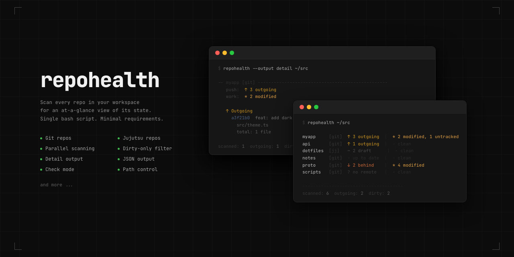

<div align="center">
  <h1>repohealth</h1>
  <p>
    <a href="./LICENSE">
      
    </a>
    <a href="https://github.com/frittlechasm/repohealth">
      
    </a>
  </p>
  
  <p><em>Scan every repo in your workspace and get a quick overview of its state.</em></p>
</div>

## Install

macOS and Linux:

```bash
curl -fsSL https://raw.githubusercontent.com/frittlechasm/repohealth/main/install.sh | sh
```

Windows PowerShell:

```powershell
iwr https://raw.githubusercontent.com/frittlechasm/repohealth/main/install.ps1 -UseB | iex
```

By default, macOS and Linux install to `~/.local/bin/repohealth` and update your shell profile when that directory is not already on `PATH`. Windows
installs to `%LOCALAPPDATA%\Programs\repohealth`, creates a `repohealth.cmd` launcher, and adds that directory to the current session and user `PATH`.
Open a new terminal after installation if your shell does not pick up `PATH` changes immediately.

To choose a directory:

```bash
curl -fsSL https://raw.githubusercontent.com/frittlechasm/repohealth/main/install.sh | sh -s -- --dir "$HOME/bin"
```

```powershell
$env:REPOHEALTH_INSTALL_DIR="$HOME\bin"; iwr https://raw.githubusercontent.com/frittlechasm/repohealth/main/install.ps1 -UseB | iex
```

For a local checkout, `chmod +x ./repohealth` is enough.

Requires `bash`, `find`, `awk`, and `git`. repohealth checks these at startup and exits with OS-specific install instructions before scanning if any
are missing. On Windows, install Git for Windows or another Bash provider first. Optionally `jj` for Jujutsu repos, `fd` for faster discovery.

## Usage

```bash
./repohealth [options] [directory]
```

If `directory` is omitted, the current directory is scanned.

Update an installed copy to the latest GitHub release:

```bash
repohealth update
```

| Flag | Description |
|------|-------------|
| `-f`, `--filter TYPE` | show repos matching `dirty`, `uncommitted`, `unpushed`, `unpulled`, or `all` |
| `-n`, `--depth N` | limit traversal depth |
| `-c`, `--check` | exit non-zero when any repo needs attention |
| `-e`, `--exclude PATTERN` | skip repos whose path matches the ERE (repeatable) |
| `-R`, `--repo PATTERN` | only show repos whose name, relative path, or full path contains the text |
| `-r`, `--remote NAME` | override remote used for Jujutsu push checks |
| `-j`, `--jobs N` | limit parallel workers (default: auto, floor 8) |
| `-o`, `--output FORMAT` | `table` · `minimal` · `detail` · `fancy-detail` · `json` |
| `-p`, `--paths STYLE` | `name` (default) · `relative` · `full` |
| `-N`, `--no-color` | disable ANSI color output |

## Output

Each repo gets one row: push state under `REMOTE`, working-copy state under `LOCAL`.
Each Jujutsu bookmark with outgoing commits gets its own indented grey row below its repo:

```
REPO               VCS  REMOTE           LOCAL
····························································
dotfiles           jj   ↑ 2 outgoing  |  - clean
  feat/zsh-prompt  jj   ↑ 2           |
myapp              git  ↑ 3 outgoing  |  * 2 modified, 1 new
notes              git  - up to date  |  - clean
```

The width comes from `COLUMNS`, then from the terminal when output goes to one, and 80 otherwise.
When the table is wider, repo names move to their own line instead of cutting statuses short.
JSON and detail output keep the full status text, such as `↑ 2 outgoing (feat/zsh-prompt: 2)`.

### Push Statuses

| Status | Meaning |
|--------|---------|
| `- up to date` | local branch matches the remote |
| `↑ N outgoing` | local commits are ready to push |
| `↑ N` | on a Jujutsu bookmark row: the outgoing commits on that bookmark |
| `↓ N behind` | remote has commits not present locally |
| `↕ A ahead, B behind` | local and remote both have unique commits |
| `~ N draft only` | Jujutsu repo has draft changes but no Git push is needed |
| `! N no-desc` | Jujutsu changes need descriptions before push |
| `? no remote` | repo has no usable remote for push checks |

### Work Statuses

`LOCAL` lists local work on one line, for example `* 7 modified, 2 new, 1 draft`.
Drafts appear here next to outgoing commits; a JJ repo with only drafts shows `~ N draft only` under `REMOTE`.

| Part | Meaning |
|------|---------|
| `- clean` | no working-copy changes |
| `N modified` | tracked files are changed, staged, deleted, or renamed |
| `N new` | untracked files: new files Git does not track yet; ignored files do not count |
| `N draft` | Jujutsu commits that are not on a bookmark yet, so they cannot be pushed |

Jujutsu tracks new files automatically, so JJ repos without a `.git` directory report them as modified.
Colocated repos read the working copy through Git, so their new files show as `new`.
JSON and detail output call new files `untracked`.

### Filters

Filters limit which repos appear in the list. Without `--filter`, repohealth shows repos with uncommitted, unpushed, or unpulled changes, plus repos
whose status check failed.

| Filter | Shows |
|--------|-------|
| `dirty` | repos with working-copy changes |
| `uncommitted` | same as `dirty` |
| `unpushed` | repos with outgoing commits, draft-only JJ changes, or no-description JJ commits |
| `unpulled` | repos behind the remote |
| `all` | every scanned repo, including clean repos |

### Output Details

| Output | Shows |
|--------|-------|
| `table` | one row per repo with push and work status, plus a row per JJ bookmark with outgoing commits |
| `minimal` | compact repo names and statuses for quick scans |
| `detail` | table output plus per-commit stat details |
| `fancy-detail` | detailed output with richer terminal formatting |
| `json` | machine-readable repo data for scripts |

To drill into one repo from a dirty summary, rerun the same parent scan with `--repo` and detail output:

```bash
./repohealth --detail --repo myapp ~/code
```

`--repo` matches the repo name, relative path, or full path. If the text matches more than one repo, all matches are shown.

For scripts, use JSON detail output:

```bash
./repohealth --output json --detail --repo myapp ~/code
```

## How it works

- Single self-contained Bash script — no build step, no daemon, no framework.
- Discovers `.git` and `.jj` repos recursively; prefers `jj` when both exist at the same root.
- Collects repo state with bounded parallel workers; renders in sorted path order for stable output.
- Uses `fd`/`fdfind` when available for faster traversal, falls back to `find`.
- Skips `node_modules`, `vendor`, `target`, `__pycache__`, `.svn`, `.hg`, and linked Git worktrees.
- Repo rows go to stdout; warnings and errors go to stderr.

## Security

The POSIX installer quotes install paths literally in shell profiles and manual PATH instructions, and rejects newline and carriage-return characters.
